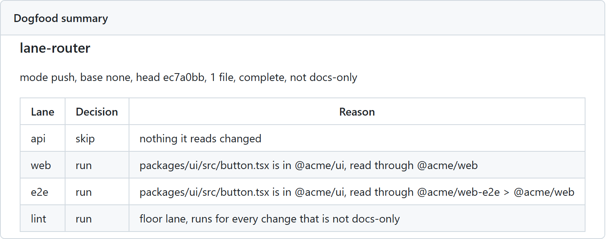

# lane-router

lane-router works out which CI test lanes a change can affect in a JavaScript monorepo, so a workflow can skip the rest. It explains every decision, and it runs every lane when it cannot be sure. It ships as a GitHub Action and as a CLI that makes the same decisions on a local diff.

A wrong skip can merge a break that no lane tested. lane-router follows workspace dependencies and explicit file rules. An unclaimed path or an unverifiable change runs every lane. An invalid config or workspace fails the step.

Run `npm run demo` to see two decisions on the bundled fixture. A change to one UI file skips the `api` lane.

```text
lane  decision  reason
api   skip      nothing it reads changed
web   run       packages/ui/src/button.tsx is in @acme/ui, read through @acme/web
e2e   run       packages/ui/src/button.tsx is in @acme/ui, read through @acme/web-e2e > @acme/web
lint  run       floor lane, runs for every change that is not docs-only
```

A path filter would treat `docs/api/users.md` as documentation. The config says the api serves that file by name, so adding it to the change turns `api` from skip to run. The other three lanes still run.

```text
api   run       docs/api/users.md matches paths[3] for @acme/api via name: The api serves these files by name.
```

## Add it to a workflow

Add a routing config at `.github/lanes.yml`. It names the lanes and the files they read. This is part of the demo's config, and the [config reference](docs/config.md) has all of it.

```yaml
lanes:
  api:
    packages: ["@acme/api"]
  lint:
    floor: true

paths:
  - match: ["docs/api/*.md"]
    packages: ["@acme/api"]
    via: name
    why: The api serves these files by name.
```

This workflow runs an existing `test:api` script when the `api` lane is selected.

```yaml
on: pull_request
permissions:
  contents: read
jobs:
  api:
    runs-on: ubuntu-latest
    steps:
      - uses: actions/checkout@v7
        with:
          fetch-depth: 0
      - id: lanes
        uses: 0x963D/lane-router@v0
      - run: npm ci
        if: steps.lanes.outputs.api != 'skip'
      - run: npm run test:api
        if: steps.lanes.outputs.api != 'skip'
```

Each run writes its decisions to the job summary. This one is from lane-router's own CI, routing the one-file change from the demo.

<picture>
  <source media="(prefers-color-scheme: dark)" srcset="docs/images/job-summary-dark.png">
  
</picture>

A missing lane output runs the job. `fetch-depth: 0` lets lane-router read the base commit. With a shallow checkout, a change to the routing config or a package manifest runs every lane in the head config. The [matrix example](docs/action.md#use-the-outputs-in-a-workflow) routes several lanes from one step.

The examples use tags so they are easy to read. In your own workflow, pin `actions/checkout` and this action to full commit SHAs, following [GitHub's security hardening guidance](https://docs.github.com/en/actions/reference/security/secure-use#using-third-party-actions).

## Docs

- [How routing works](docs/routing.md): why path filters miss dependencies, and how the base and head graphs stop a change from rewriting its own test coverage.
- [Config reference](docs/config.md): every key and validation rule, with the demo's full config.
- [Action inputs and outputs](docs/action.md), including the matrix workflow.
- [Running locally](docs/running-locally.md): the CLI, the demo and the development commands.
- [Fail-closed guarantees](docs/fail-closed.md): every case that runs every lane or fails the step, which files the Action will read, and why workflow files need review rules.
- [Limitations](docs/limitations.md): what v0.1 does not do.
- [Decision records](docs/decisions/README.md): each design choice and the code that implements it.
- [Routing evidence](docs/evidence.md) covers mutation testing, a soundness oracle and real workspace replays.

## When Turborepo or Nx is the better tool

Choose Turborepo or Nx when you want affected detection to run tasks and reuse cached results. Turborepo's [`--affected` option](https://turborepo.dev/docs/reference/run#--affected) selects changed packages and their dependents by default. [`nx affected`](https://nx.dev/docs/features/ci-features/affected) selects tasks from changed inputs and dependent task outputs. It runs the selected tasks and their dependencies, with unchanged dependencies restored from cache.

lane-router selects named CI lanes and emits decisions with reasons. It does not run tasks or cache results. It fits existing workflow jobs that need explicit routing rules for workspace dependencies and files read by name.

## Origin

lane-router started as CI routing I built for a private production monorepo, where every change ran every test lane. This repository is a rewrite of that idea as a standalone Action and CLI, built from a written description of the behaviour and not from the original code.
